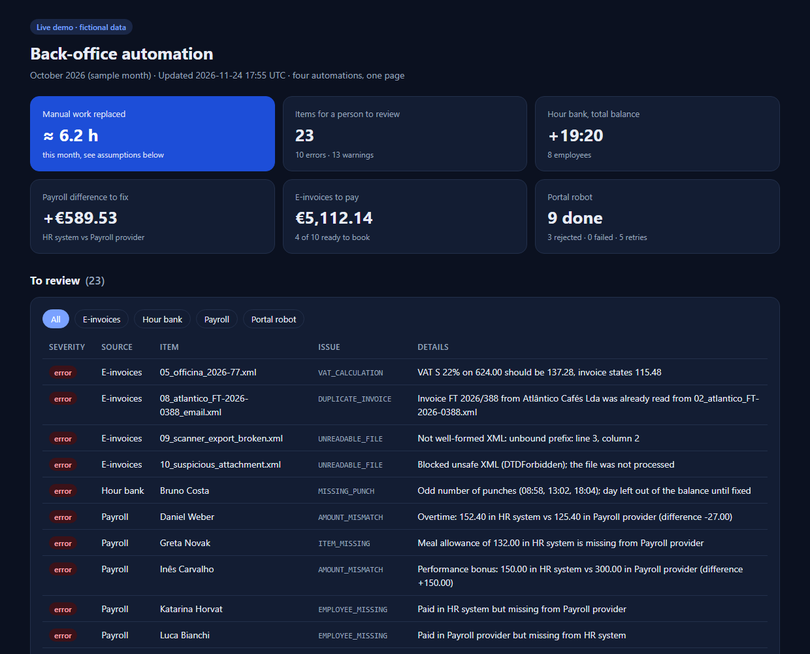

# Back-office Automation Dashboard

[](https://github.com/alelexand/back-office-dashboard/actions/workflows/tests.yml)
[](https://github.com/alelexand/back-office-dashboard/actions/workflows/publish.yml)


### ▶ [Open the live dashboard](https://alelexand.github.io/back-office-dashboard/)

One page that brings together the results of four back-office automations, plus **one list of everything a person still has to fix**. People look at a single to-do list instead of four reports.



> All people, companies and amounts are fictional.

## The automations behind it

| Automation | What it does | Feeds the dashboard with |
|---|---|---|
| [hour-bank-checker](https://github.com/alelexand/hour-bank-checker) | Time-clock punches into hour bank balances, flags missing punches and rest violations | Balance per employee, issues |
| [payroll-reconciliation](https://github.com/alelexand/payroll-reconciliation) | Compares the HR system with the payroll provider, item by item | Net differences, missing employees and items |
| [einvoice-reader](https://github.com/alelexand/einvoice-reader) | Reads UBL/CII e-invoices and checks EN 16931 rules | Amount due per supplier, VAT by rate, invalid files |
| [portal-robot](https://github.com/alelexand/portal-robot) | Web robot that downloads reports and fills in forms | Done / rejected / failed tasks, retries |

## How it is built

```
          GitHub Actions (every push, every Monday, or on demand)
 ┌────────────────────────────────────────────────────────────────────┐
 │  clone the 4 repositories → run each one on its sample data        │
 │     hour_bank_2026-10.xlsx   payroll_reconciliation_2026-10.xlsx   │
 │     einvoices.sqlite         robot/summary.xlsx                    │
 │  → python -m dashboard → site/index.html → GitHub Pages            │
 └────────────────────────────────────────────────────────────────────┘
```

- **Decoupled by design.** The dashboard reads each tool's *export* (Excel or SQLite), never its code. Any automation can be replaced as long as its export keeps the same columns, and a missing source just leaves its section empty.
- **The pipeline is the demo.** The [refresh workflow](.github/workflows/publish.yml) really runs all four automations, including a headless browser for the robot, and publishes the result. The live page is rebuilt from scratch each time.
- **One static file.** The page needs no server, no database and no external JavaScript. The data is embedded as JSON and rendered with plain DOM APIs (no `innerHTML`), so the content can't inject scripts. It works in dark mode and on mobile.
- **Honest numbers.** "Manual work replaced" comes from explicit, editable assumptions (minutes per invoice, per pay item…) that are listed at the bottom of the page.

## Run it locally

```bash
git clone https://github.com/alelexand/back-office-dashboard.git
cd back-office-dashboard
pip install -r requirements.txt

python -m dashboard --inputs sample_inputs --period "October 2026" --out site/index.html
```

`sample_inputs/` holds one export from each automation, so this works without installing the other four projects. You can also point to individual files and override the time assumptions:

```bash
python -m dashboard --hour-bank hb.xlsx --payroll pay.xlsx --einvoices inv.sqlite --robot summary.xlsx \
                    --assumptions my_minutes.json --out site/index.html
```

```json
{ "minutes_per_employee_day": 1, "minutes_per_payroll_item": 0.5, "minutes_per_invoice": 6, "minutes_per_portal_task": 4 }
```

## Tests

```bash
pip install pytest
pytest
```

The tests cover each reader, how issues from all sources are merged and sorted, duplicate invoices left out of totals and VAT, the time estimate, and safe embedding of data in the page.

## License

MIT. Built by [Alexandre Lasse](https://alelexand.github.io), freelance developer of automation and custom software for SMEs. Want this for your own back office? [Get in touch](https://alelexand.github.io/#contact).
